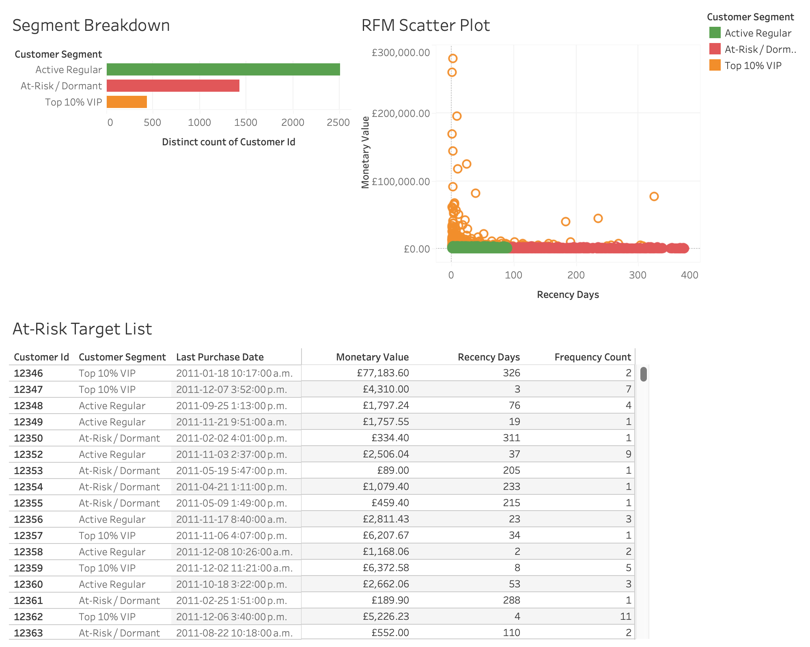

# Customer Retention & RFM Churn Analytics Dashboard
End-to-end RFM customer segmentation and churn analytics pipeline built with SQL and Tableau. Models 4,371 retail accounts using NTILE deciles and a 90-day dormancy threshold to surface £743K+ in at-risk revenue and generate prioritized CRM win-back lists.

**[View Live Interactive Dashboard on Tableau Public](https://public.tableau.com:9443/views/CustomerRetentionRFMChurnDashboard/Dashboard1?:language=en-US&:sid=&:redirect=auth&showOnboarding=true&:display_count=n&:origin=viz_share_link)**

## Executive Summary
Acquiring new e-commerce customers is significantly more expensive than retaining existing ones. This end-to-end Business Analysis and Data Analytics project transforms raw transactional logs from the **UCI Online Retail Dataset** into an actionable **RFM (Recency, Frequency, Monetary)** customer segmentation model and an interactive executive retention dashboard.

The solution enables marketing and customer success teams to identify high-value customers approaching churn, quantify revenue at risk, and immediately export prioritized CRM win-back lists.

---

## Business Problem & Methodology
* **Objective:** Segment 4,371 unique customer accounts by purchasing behavior and flag dormant accounts for targeted retention campaigns.
* **Data Modeling & Transformation (SQL):** 
  * Audited and cleaned raw transaction records (filtering out null customer IDs, cancelled invoices, and invalid unit prices/quantities).
  * Computed account-level **Recency** (days since last purchase), **Frequency** (total distinct invoices), and **Monetary Value** (total net spend).
  * Applied `NTILE(10)` decile ranking to isolate the top 10% highest-spending accounts (`Top 10% VIP`).
  * Established a **90-day inactivity threshold** (`Recency > 90 days`) to classify dormant accounts (`At-Risk / Dormant`) versus active buyers (`Active Regular`).

---

## Key Findings
* **Customer Base Composition:** Out of **4,371 total customers**, **1,431 accounts (~32.7%)** have crossed the 90-day dormancy threshold and are classified as `At-Risk / Dormant`.
* **Revenue Exposure:** The `At-Risk / Dormant` segment represents **£743,321.65** in historical cumulative spend, making automated win-back sequences a high-ROI priority.
* **VIP Concentration:** The `Top 10% VIP` tier (~437 accounts) drives a disproportionate share of total revenue, with top individual accounts exceeding **£280,000** in lifetime value.

---

## Dashboard Architecture

1. **Segment Breakdown:** Horizontal bar chart displaying customer distribution across `Active Regular`, `At-Risk / Dormant`, and `Top 10% VIP` tiers. Clicking any segment dynamically filters the entire dashboard.
2. **RFM Behavioral Scatter Plot:** Maps `Recency Days` against `Monetary Value` to visually isolate high-value outliers slipping past the 90-day churn boundary.
3. **Actionable CRM Target List:** A sortable, multi-metric table displaying `Customer Id`, `Last Purchase Date`, `Monetary Value`, `Recency Days`, and `Frequency Count`—sorted descending by spend so CRM teams prioritize top-value accounts first.

---

## Repository Structure
```text
├── assets/
│   ├── as_is_workflow.png          # Swimlane process diagram
│   ├── dashboard_at_risk_view.png  # Filtered At-Risk / Dormant segment view
│   └── dashboard_overview.png      # Unfiltered Tableau Executive Dashboard
├── dashboard/
│   └── customer_retention_dashboard.twb # Packaged Tableau workbook
├── data/
│   ├──customer_segments.csv         # Aggregated RFM & segment dataset (4,371 rows)
│   └── data_dictionary.md           # Schema & metric definitions
├── requirements_docs/
│   ├── BRD.pdf                      # BRD & Stakeholder Analysis 
│   ├── Data_Profiling_Audit.pdf     # Data cleaning & quality validation notes
│   └── RTM.pdf                      # RTM linking business rules to SQL & visuals     
├── sql/
│   └── rfm_segmentation.sql        # SQL cleaning, NTILE deciles & 90-day churn logic
├── LICENSE                         # MIT License
└── README.md                       # Master case study & links to all
